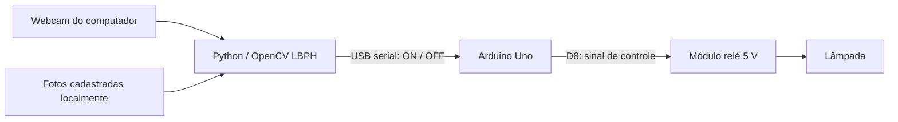

# FaceLight — reconhecimento facial com Arduino Uno

Um rosto cadastrado aciona uma lâmpada por meio de um módulo relé 5 V. Python faz o reconhecimento na webcam do computador; o Arduino Uno recebe comandos USB e controla o relé. Interface em português para cadastrar e testar o rosto.



## Você vai precisar

- Windows 10/11, Python **3.12 de 64 bits**, webcam e porta USB.
- Arduino Uno e cabo USB de dados.
- Módulo relé 5 V com circuito de acionamento compatível com a saída do Uno.
- Lâmpada e instalação elétrica adequada. Para **127/220 V**, siga [as orientações de hardware](docs/hardware.md) e use um profissional qualificado.
- Arduino IDE para gravar o programa no Uno.

O Uno não executa o reconhecimento: o computador precisa permanecer ligado. Não são necessários GPU, API externa, conta de IA ou download de pesos. O detector Haar e o reconhecedor LBPH vêm no OpenCV contrib.

## Instalar no Windows

Abra o PowerShell **na pasta do projeto**, onde está este README. Instale o Python 3.12 de 64 bits antes de executar:

```powershell
py -3.12 -m venv .venv
.\.venv\Scripts\python.exe -m pip install --require-hashes -r requirements.txt
.\.venv\Scripts\python.exe -m streamlit run app.py --server.address 127.0.0.1
```

Abra no navegador o endereço local mostrado pelo Streamlit. Os comandos usam o Python da pasta `.venv`, sem precisar alterar a política de execução do PowerShell. As dependências estão fixadas e têm hashes em `requirements.txt`, exportado do `uv.lock`.

Alternativa para quem já usa [uv](https://docs.astral.sh/uv/):

```powershell
uv sync --locked
uv run streamlit run app.py --server.address 127.0.0.1
```

## Cadastrar e testar

1. Na etapa **Cadastrar rosto**, envie pelo menos **5 fotos diferentes da mesma pessoa**, ou capture-as pela câmera do navegador. Recomendado: 10 a 20 fotos frontais, com pequenas variações de pose, distância e iluminação. Não misture pessoas no mesmo cadastro.
2. Na etapa **Testar reconhecimento**, use uma foto nova da pessoa. Teste também pessoas não cadastradas antes de ligar qualquer carga.
3. Ajuste o **limite LBPH**. Valores menores são mais rigorosos; valores maiores podem aceitar outras pessoas. `65` é apenas um ponto de partida. A distância exibida não é porcentagem de confiança.
4. Depois de mudar o cadastro, reinicie o monitor para carregar as novas amostras. Há apenas um cadastro de pessoa; para trocá-la, pare o monitor e exclua as fotos pela interface.

As fotos são recortadas em faces de 160 × 160 pixels e salvas em `data/samples/`, excluída do Git. Nenhuma foto de demonstração fica cadastrada. Não publique essa pasta. No computador local, os dados permanecem nele; se executar a interface na nuvem, os uploads são processados e salvos no servidor da nuvem.

## Gravar o Arduino

1. Abra [arduino/face_lamp/face_lamp.ino](arduino/face_lamp/face_lamp.ino) na Arduino IDE.
2. Selecione a placa **Arduino Uno** e sua porta USB, e envie o sketch.
3. O código assume módulo **ativo em LOW** no pino **D8**. Se seu módulo for ativo em HIGH, ajuste `RELAY_ACTIVE_LOW` para `false` antes de gravar.
4. Feche o Monitor Serial da IDE antes de iniciar o programa Python.
5. Teste inicialmente apenas o Arduino e o módulo, com a instalação de 127/220 V desconectada. O LED embutido do Uno acompanha o estado solicitado.

## Reconhecer continuamente e acionar a lâmpada

Feche a captura de câmera do navegador. Em outro PowerShell, na mesma pasta do projeto:

```powershell
# Descobrir a porta do Uno
.\.venv\Scripts\python.exe -m vision.monitor --list-ports

# Primeiro: testar a webcam, sem enviar comandos a um Arduino
.\.venv\Scripts\python.exe -m vision.monitor --simulate --threshold 65

# Depois: substitua COM3 pela porta exibida para o seu Uno
.\.venv\Scripts\python.exe -m vision.monitor --port COM3 --threshold 65
```

Com uv, substitua `.\.venv\Scripts\python.exe` por `uv run python`.

O monitor usa a webcam diretamente e escreve o estado no terminal; ele não abre uma janela de vídeo. Pressione **Ctrl+C** para encerrar. Para uma segunda câmera, acrescente `--camera 1`. Somente um monitor deve controlar o Arduino.

### Comportamento

- Três reconhecimentos consecutivos autorizam o primeiro acionamento (`--confirmations 3`).
- A luz permanece ligada durante o reconhecimento e por até cinco segundos após a última confirmação (`--hold 5`). Um rosto desconhecido durante esse intervalo não prolonga a autorização.
- Mais de um rosto no quadro cancela a autorização e desliga imediatamente.
- A cada meio segundo, Python renova o comando. Se o Arduino ficar **3 segundos sem comando válido**, ele desliga a saída por watchdog.
- Erro de câmera, falha serial ou Ctrl+C encerra o monitor e tenta enviar `OFF`. Se a comunicação cair, o watchdog continua atuando no Uno enquanto ele estiver alimentado.
- Na abertura da porta, Python aguarda o reset do Uno e confirma `OFF` antes de começar. Comandos sem resposta válida fazem o programa parar.

O tempo de três segundos do watchdog é fixado no sketch. O comando `--hold` controla apenas o tempo normal de permanência da luz.

## Limitações e solução de problemas

Este é um **protótipo didático para iluminação**, sem detecção de presença real: uma foto pode ser aceita. Haar/LBPH é sensível à posição e à iluminação e pode confundir pessoas. As confirmações consecutivas reduzem oscilações, mas não garantem identidade. Não use como fechadura ou mecanismo de segurança.

| Situação | O que verificar |
| --- | --- |
| Nenhum rosto detectado | Ilumine o rosto de frente; evite perfil; aproxime-se para ocupar pelo menos 80 × 80 pixels. |
| Pessoa cadastrada rejeitada | Cadastre fotos no ambiente real, use outras poses frontais e calibre com fotos novas. |
| Outra pessoa aceita | Reduza o limite e refaça o cadastro. Mantenha a carga desconectada durante a calibração. |
| Câmera indisponível | Feche navegador, Teams e outros programas que usam a webcam; tente `--camera 1`. |
| Porta COM não abre | Feche a Arduino IDE/Monitor Serial, confira a porta e o cabo de dados. Clones podem exigir o driver USB do fabricante. |
| Arduino não confirma | Grave o sketch correto, use 9600 baud e confira se a COM pertence ao Uno. |
| Relé funciona ao contrário | Confira a lógica LOW/HIGH do módulo e o uso de contato normalmente aberto pelo instalador. |
| Mudança de cadastro não aparece | Pare e reinicie o monitor; o modelo fica em memória durante a execução. |

## Desenvolvimento e testes

```bash
uv sync --locked
uv run pytest -q
uv run ruff check .
uv run ruff format --check .
```

Os testes cobrem cadastro e rejeição de duplicatas, treinamento/predição LBPH, imagens inválidas, temporização da luz, confirmações seriais, falha da câmera e navegação na interface. O teste do sketch compila o código real com GPIO, serial e relógio simulados em C++; requer `g++` e é pulado quando ele não está disponível. Essa simulação não substitui compilação para AVR, gravação e teste físico no Uno.

Para atualizar a exportação pip após mudar dependências:

```bash
uv lock
uv export --locked --no-dev --format requirements-txt --output-file requirements.txt --quiet
```

## Ambiente na nuvem

A nuvem executa a interface, os testes e as simulações, mas não acessa a webcam nem o USB do computador Windows. O acionamento físico deve rodar no PC conectado ao Arduino. O cadastro feito na nuvem não é transferido automaticamente para o Windows; faça o cadastro no PC onde usará a lâmpada.

```bash
uv sync --locked
uv run streamlit run app.py --server.address 127.0.0.1
```

Os arquivos `uv.lock` e `requirements.txt` permitem reproduzir a instalação. Não há credenciais ou serviços externos obrigatórios.
